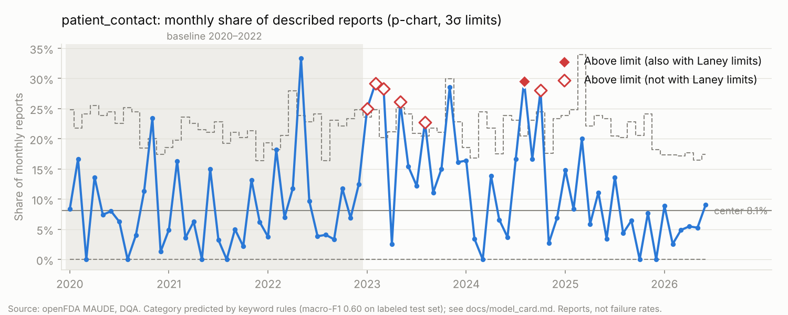

# Post-market surveillance of pulse oximeters with FDA MAUDE data

An end-to-end analysis of 14,234 public FDA adverse event reports for pulse oximeters (product code DQA): reproducible download, SQL analysis, a manually labeled failure taxonomy, text classification, statistical trend detection, and a small risk review inspired by medical device quality standards.



## Questions
1. Which failure types are reported most often, and how do they change over the years?
2. Which failure types are growing fastest?
3. How well can a text classifier assign a failure type from the free-text report narrative?

## Key findings
- **Reporting is concentrated:** manufacturers file 95% of reports, and one company dominates each era (Covidien/Nellcor 74–93% of reports in 2005–2011, Masimo 54–88% in 2014–2019). Many apparent "trends" in FDA problem terms reflect who reports and how they code, not device behavior ([`docs/queries.md`](docs/queries.md)).
- **Failure taxonomy from the narratives:** 10 categories designed from a pulse-oximetry (PPG) engineering view, applied by hand to 300 stratified reports, then audited for consistency against written rules ([`docs/labeling_guide.md`](docs/labeling_guide.md)).
- **Text classification:** on reports from 2020 onward (trained on earlier ones), keyword rules reached macro-F1 0.60 (95% CI 0.48–0.70) and TF-IDF + logistic regression 0.43. With 180 training texts, written domain rules beat the learned model ([`docs/model_card.md`](docs/model_card.md)).
- **Trend signals (p-charts with Laney over-dispersion check):** two signals confirmed by two independent codings (alarm problems in late 2025; device shutdowns in 2023, each concentrated in one manufacturer group), and one signal visible only with the new taxonomy: a sustained rise of patient-contact injuries (burns, blisters, pressure injuries) during 2023 across several manufacturers ([`docs/trends.md`](docs/trends.md)).
- **Risk review:** among described reports, alarm failures account for about half of those coded as Death (187 of 361) and patient-contact failures for the largest share of those coded as Injury (263 of 589) ([`docs/regulatory/`](docs/regulatory/)).

## Important limitations
MAUDE is a **passive** reporting system. Reports are not extensively validated, under-reporting is likely, and the number of devices in use is unknown. This project **does not** establish causality, incidence, or the safety of any specific product or manufacturer. Counts describe *reports*, not *events in the population*. Trend signals are prompts to read reports, not conclusions. See [`docs/scope.md`](docs/scope.md).

## Project structure
```
src/         Python scripts: download, tables, queries, labeling, classification, control charts
sql/         10 documented SQL queries
tests/       Independent pandas cross-check of the SQL results
docs/        Scope, data dictionary, query results, labeling guide, model card, trends, regulatory dossier
results/     Query outputs (CSV), classification metrics, control charts (PNG)
labels/      300 manually labeled descriptions, audit log, pre-audit version
data/        Local database (not committed; rebuilt by src/download.py)
```

## How to reproduce (Windows commands; use `/` paths on macOS/Linux)
1. Get a free openFDA API key: https://open.fda.gov/apis/authentication/
2. Copy `.env.example` to `.env` and paste your key. `.env` is ignored by Git.
3. Create a virtual environment and install dependencies:
   ```
   python -m venv .venv
   .venv\Scripts\activate
   pip install -r requirements.txt
   ```
4. Download and analyze (results change slightly as FDA adds reports every week; the documented snapshot is 2026-11-24):
   ```
   python src\download.py
   python src\build_tables.py
   python src\run_queries.py
   python tests\check_queries.py
   python src\control_charts.py
   ```
5. Classify with the existing labels and chart predicted categories:
   ```
   python src\classify.py
   python src\predict_all.py
   python src\control_charts.py --by predicted
   ```
Optional: `src\explore_api.py` (first look at the API), `src\make_label_sample.py` and `src\make_label_workbook.py` (how the labeling sample was drawn), `src\consistency.py` (label consistency re-test).

## Status
- [x] 1. Scope and limitations
- [x] 2. Reproducible download into SQLite ([`docs/data_dictionary.md`](docs/data_dictionary.md))
- [x] 3. Documented SQL queries ([`docs/queries.md`](docs/queries.md))
- [x] 4. Text classification with audited manual labels ([`docs/model_card.md`](docs/model_card.md))
- [x] 5. Trend detection with control charts ([`docs/trends.md`](docs/trends.md))
- [x] 6. Regulatory-inspired dossier, inspired by ISO 13485 and ISO 14971; **not** a compliance claim ([`docs/regulatory/`](docs/regulatory/))
- [x] 7. Data dictionary and model card
- [ ] Label consistency re-test (30 reports re-labeled one week later)

## Use of AI assistance
Code and documentation drafts were written with an AI assistant (Claude) and reviewed by the author. The failure taxonomy, all 300 labels, and every audit and severity decision are the author's. How the assistant was involved in the label audit, and the bias this may introduce, is documented in [`docs/model_card.md`](docs/model_card.md).

## Data source and license
Data: U.S. Food and Drug Administration, openFDA Device Adverse Event API (https://open.fda.gov/apis/device/event/). This project is not affiliated with or endorsed by the FDA. Report narratives are public records as published by FDA, with FDA's own redactions.
Code: MIT License (see `LICENSE`).

Author: Alfonso Kiyoshi López Vieyra, Biomedical Engineering, Instituto Tecnológico de Morelia (TecNM).
